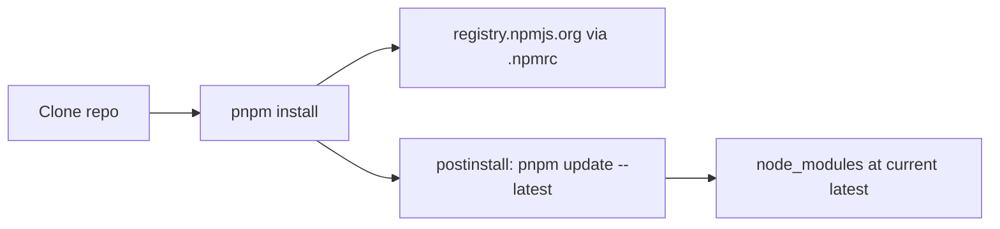

# Install Dew packages from npm `latest`

## Goal
New clones that run `pnpm install` get the current `latest` of all four Dew packages from [npmjs.org](https://www.npmjs.com), not snapshots under `vendor/`.

## Why a postinstall refresh is required
`package.json` `"latest"` alone is not enough: a committed [pnpm-lock.yaml](pnpm-lock.yaml) pins resolved versions, so a plain `pnpm install` would keep shipping whatever was last locked. A small postinstall step re-resolves the four packages to the current `latest` tag after install.



## Changes

### 1. Point `@freshworks` at the public registry
Add [`.npmrc`](.npmrc) at the repo root:

```properties
@freshworks:registry=https://registry.npmjs.org/
```

This overrides a global `@freshworks:registry=https://npm.pkg.github.com` (common inside Freshworks) so installs hit the public packages.

### 2. Switch dependencies to `latest`
In [package.json](package.json):

- Set all four to `"latest"`:
  - `@freshworks/dew-components`
  - `@freshworks/dew-styles`
  - `@freshworks/dew-mcp-server`
  - `@freshworks/dew-theme-generator`
- Remove the npm `"overrides"` block that forced `file:` styles
- Update `description` (no longer a vendored offline kit)
- Add `"postinstall": "node scripts/refresh-dew-latest.mjs"`

### 3. Refresh script
Add [scripts/refresh-dew-latest.mjs](scripts/refresh-dew-latest.mjs):

- No-op when `DEW_SKIP_LATEST=1` (recursion / CI escape hatch)
- No-op when the install user-agent is not pnpm (npm/yarn won’t run `pnpm update`)
- Run:
  `pnpm update @freshworks/dew-components @freshworks/dew-styles @freshworks/dew-mcp-server @freshworks/dew-theme-generator --latest --ignore-scripts`
  with `DEW_SKIP_LATEST=1` in the env so the nested install does not loop
- Keep `"latest"` in `package.json` (update refreshes the lockfile, not the specifier)

### 4. Drop vendoring / file overrides
- Remove the `overrides` entry from [pnpm-workspace.yaml](pnpm-workspace.yaml) (keep `allowBuilds`)
- Delete `vendor/@freshworks/dew-components`, `dew-styles`, `dew-mcp`, `dew-theme-generator` (and `vendor/` if empty)
- Regenerate [pnpm-lock.yaml](pnpm-lock.yaml) via `pnpm install` against the registry
- Leave the stale root [package-lock.json](package-lock.json) alone unless it blocks work; it already points at removed `file:` paths and is unused by pnpm

### 5. Rewrite [README.md](README.md)
Replace the “vendored / GitHub Packages workaround” story with:

- Packages install from npmjs.org at `latest`
- Project `.npmrc` ensures the public registry for `@freshworks`
- `pnpm install` refreshes Dew to current `latest` (mention `DEW_SKIP_LATEST=1` to skip)
- Simple install examples using registry package names (no `file:` / vendor copy instructions)
- Keep the demo-app quick start; drop “Updating vendored packages”

### 6. Verify
- `pnpm install` resolves all four from `registry.npmjs.org` and ends on current `latest`
- `pnpm build` still succeeds
- Confirm `node_modules/@freshworks/*` are not symlinks into `vendor/`

## Trade-off (intentional)
Installs can rewrite `pnpm-lock.yaml` when newer Dew releases exist. That is the point of floating `latest`; use `DEW_SKIP_LATEST=1 pnpm install` when a frozen install is needed.
