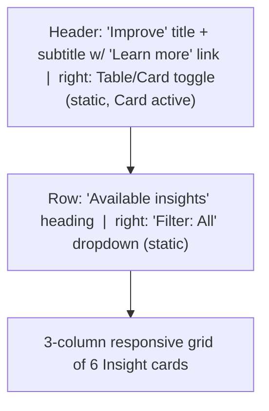

# Bring the "Improve" screen content into Agent Studio

## Scope and intent
The Figma node is the **Improve** view of AI Agent Studio. It maps onto the existing screen at [src/routes/freshservice/agent-studio/AgentStudio.tsx](src/routes/freshservice/agent-studio/AgentStudio.tsx), which today always renders the **Performance** dashboard. Per your choice, we **replace the Performance content entirely** with the Improve content.

What stays untouched (no edits):
- Rail sidebar (`RailNav`) and top header (`AppTopNav`) in [src/routes/freshservice/Freshservice.tsx](src/routes/freshservice/Freshservice.tsx)
- The agent secondary nav (`SecondaryNav`, the `Overview/Build/Test/Deploy/Analyze` panel) inside `AgentStudio.tsx`
- Routing in [src/App.tsx](src/App.tsx) (the `/freshservice/agent-studio` route already exists)

## Layout of the new content area
Rendered to the right of `SecondaryNav`, inside the existing scroll container in `AgentStudio`:



Each **Insight card** (bordered, rounded `Panel`-style) contains:
- Top row: status `Tag` (colored dot + label) on the left, source `Icon` on the right
- Body: the insight description text
- Meta: `Based on N conversations` and `Last updated · 2 days ago`
- Footer: `Review content` link button (`suffixIcon="ArrowRight"`); first card also shows a dismiss (x) icon button

Status → Tag variant mapping (verify exact Dew variant names against `vendor/@freshworks/dew-components` during build):
- `Edit content` → blue/info
- `New content` → green/success
- `Content conflict` → yellow/warning

## Card data (hardcoded sample, matching the design)
- Edit content - "Customers struggle to reset their passwords, leading to repeat support requests." - 140 conversations
- New content - "Customers frequently ask how to reset their passwords because no clear help article exists." - 122
- Content conflict - "Different password reset instructions across sources are causing customer confusion." - 117
- Edit content - "Unclear refund timelines are causing customers to repeatedly follow up after cancellations." - 100
- New content - "Missing guidance on changing delivery addresses is forcing customers to reach out to support." - 80
- Edit content - "Customers frequently ask about delayed shipments because no clear tracking or delay guidance..." - 74

## Edits to `AgentStudio.tsx`
- Keep `SecondaryNav`, `NavRow`, `NavLeaf`, `SectionHeading`, and `Panel`.
- Set the default active secondary-nav item to `'improve'` (currently `'performance'`) so the highlight matches the screen being shown:

```617:618:src/routes/freshservice/agent-studio/AgentStudio.tsx
export default function AgentStudio() {
  const [activeNav, setActiveNav] = useState('performance');
```

- Replace the entire Performance content block (the inner `<div>` with page header + all `Panel`s / charts / tables, lines ~624-737) with a new `ImproveContent` component (header + `Available insights` row + card grid).
- Remove the now-unused Performance-only helpers and data: `JourneyChart`, `PerformanceOverTime`, `TopicDistribution`, `ChannelDonut`, `FeedbackCard`, `Helpfulness`, `ViewLink`, `TableSection`, and the `SERVICE_*`/`WORKFLOW_*`/`KNOWLEDGE_*` constants/columns, plus the unused `Table`/`ColumnDef` imports. Add new card components + the insight data array.

## Styling conventions
Follow the file's existing patterns: inline `style` objects with Dew CSS tokens (`var(--color-...)`, `var(--spacing-...)`), Dew `Icon`/`Tag`/`TextButton` components. Card grid uses CSS grid (`repeat(auto-fill, minmax(~320px, 1fr))`) so it stays responsive within the content area.

## Verification
- Run the dew dev server and open `/freshservice/agent-studio`; confirm the Improve card grid renders, rail + top header + secondary nav are unchanged, and no lint/TS errors remain.