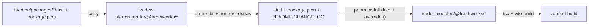

## Update and slim the vendored Dew packages

### Goal
Pull the updated `dew-styles` and `dew-components` builds from `/Users/strinkaus/Projects/fw-dew` into `vendor/@freshworks/`, and make the vendoring leaner by keeping only what the `file:` dependency actually consumes.

### Why lean is safe
Each package's `package.json` declares `"files": ["dist"]`, and the starter only imports from `dist/` ([src/styles/index.css](src/styles/index.css), component ESM imports). The vendored `src/`, nested `node_modules/`, `docs/`, `tests/`, `.storybook/`, `.cursor/`, and config files are never used by a consumer.

### Lean target layout (per package)
Keep only:
- `dist/` (with `.br` precompressed files removed — Vite never serves them)
- `package.json`
- `README.md`, `CHANGELOG.md`

Remove (git rm) the rest: `src/`, `node_modules/`, `docs/`, `scripts/`, `tests/`, `.storybook/`, `pipeline-scripts/`, `.cursor/`, and all loose config files (`vite.config.ts`, `tsconfig*.json`, `eslint.config.mjs`, `.prettierrc`, `.stylelintrc.json`, `bundlesize.config.json`, `project.json`, `tailwind.config.js`, `postcss.config.js`, `.babelrc`, `.lintstagedrc.json`, `sonar-project.properties`, `.gitignore`, `.DS_Store`).

This drops the tracked vendor footprint for these two packages from ~5,700 files to ~1,300 (mostly the components icon chunks).

### Flow

### Steps

1. dew-styles
   - `git rm -r` the non-published extras listed above from `vendor/@freshworks/dew-styles/`.
   - Replace `vendor/@freshworks/dew-styles/dist/` with a fresh copy of `/Users/strinkaus/Projects/fw-dew/packages/dew-styles/dist/`, then delete the `*.br` files.
   - Copy over `package.json` (0.8.1), `README.md`, `CHANGELOG.md`.

2. dew-components
   - `git rm -r` the non-published extras (including nested `node_modules/@freshworks/dew-styles`; the root pnpm override resolves dew-styles to the vendored copy).
   - Replace `vendor/@freshworks/dew-components/dist/` with a fresh copy of `/Users/strinkaus/Projects/fw-dew/packages/dew-components/dist/`, then delete the `*.br` files.
   - Copy over `package.json`, `README.md`, `CHANGELOG.md`.

3. Re-track dist
   - `dist` is in `.gitignore`, so re-add with `git add -f vendor/@freshworks/dew-styles/dist vendor/@freshworks/dew-components/dist`.

4. Docs
   - Update the version table in [README.md](README.md) (`dew-styles` 0.7.1 to 0.8.1; note the dew-components rebuild).

5. Install + verify (pnpm)
   - Run `pnpm install` to refresh `node_modules` and `pnpm-lock.yaml` from the updated `file:` packages.
   - Run `pnpm build` (`tsc && vite build`) to confirm the demo app still type-checks and bundles against the new builds; fix any fallout (most likely none, since component APIs stayed at 1.0.1).

### Notes / decisions
- Keeping `.cjs` and `.d.ts` inside `dist/` preserves the package `exports` map and types. An optional further trim (dropping `.cjs` too, ESM-only) would require editing the `require` condition in `dew-components/package.json` — not included by default.
- `dew-mcp` and `dew-theme-generator` are left untouched (out of scope).
- The stale npm `package-lock.json` can optionally be removed since the project now uses pnpm — flagged, not done by default.
